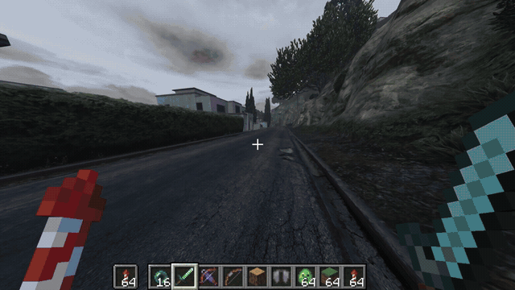
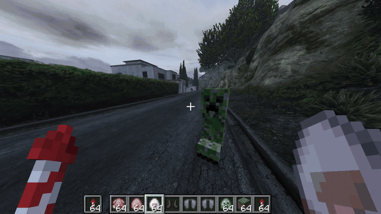
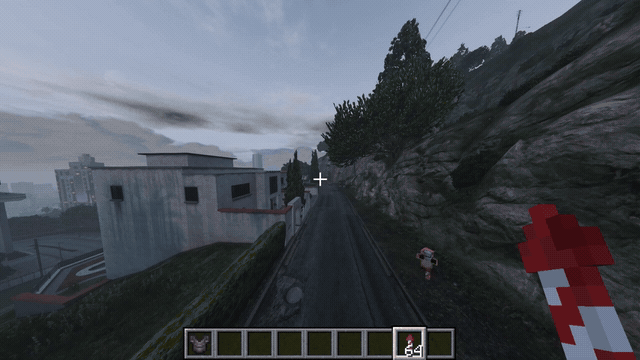
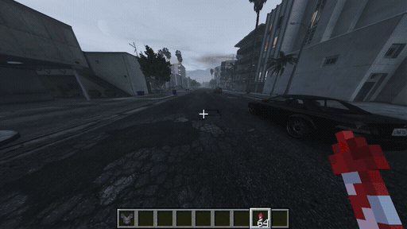

# Minecraft × GTA V

**Play real Minecraft inside Los Santos.**

An experimental Windows mod that runs Minecraft Java alongside GTA V Legacy Story Mode. Build on GTA streets, play as your Minecraft character, and fly between skyscrapers with an elytra.

This version focuses on Minecraft movement: walking, strafing, sprinting, sneaking, jumping, creative flight, and elytra physics, with terrain and camera collision work to make the two games fit together.

## Gameplay

## Current features

- Your Minecraft skin, first-person and third-person views, pose changes and vanilla movement FOV effects.
- Minecraft controls by default; switch to native GTA controls for driving.
- Building and breaking Minecraft blocks; placed blocks mirrored to GTA collision objects.
- Minecraft hotbar, held items, HUD, creative inventory/search, offhand items, chat and commands.
- Persistent builds in a dedicated Minecraft world.
- Creative flight, elytra steering and firework boosts.
- TNT/creeper explosions, bows/crossbows, melee and ender pearls with GTA effects.
- Experimental mobs versus GTA characters/police and cross-game damage.
- Floor, wall, ceiling and camera collision handling, plus experimental moving-platform support.
- Experimental survival health/damage and Nether-themed portal, mob and fire/lava interactions.
- Depth-aware rendering, ambient lighting/grade, opaque block lighting fix and extra world image around the screen edges for camera turns.

## Controls

| Key | Action |
|---|---|
| W A S D / mouse | Move / look |
| Space / Ctrl / Shift | Jump / sprint / sneak |
| E | Inventory |
| Left / right click | Attack or break / use or place |
| 1–9 / wheel | Hotbar |
| F / Q | Swap offhand / drop |
| F5 | Perspective |
| T / slash | Chat / command |
| F8 | Minecraft ↔ GTA controls |
| F7 | Passthrough on/off |
| F9 | Re-level ground |

Creative: double-tap Space to fly; Space rises, Shift descends. Elytra: equip in the chest slot, press Space while airborne, steer with the mouse and use fireworks to boost.

## Status and limitations

Experimental release 0.1.8 adds active Ender Dragon combat and GTA collision samples for nearby mobs. Both production components build, automated combat regression checks pass, and the Minecraft 26.3 runtime reached its ready message. Both Melty projects accept 0.1.8 as test drafts. Full GTA street gameplay testing remains pending. See [all fixes in 0.1.8](CHANGELOG-0.1.8.md).

Collision on unusual surfaces, shaped blocks, moving platforms and fast camera turns needs broader testing. Recent turn snapshots confirmed filled screen edges but do not prove every transient frame. Some inherited combat/Nether systems have not been reverified in the latest build. Both games run simultaneously and require substantial resources. GTA roads/buildings cannot be mined. GTA Enhanced and GTA Online are not supported by this version.

## Setup and builds

Supported development versions: Minecraft Java 26.3, Fabric Loader 0.19.5, Fabric API 0.161.0+26.3, Java 25; GTA V Legacy build 3889 and ReShade 6.8.0 with add-on support.

The Melty release contains the rebuilt GTA ASI, Fabric mod, shader, ReShade runtime, portable Prism launcher, Java and Fabric API. `melty.json` maps every file and starts both games. Melty installs Ultimate ASI Loader; ScriptHookV is no longer imported or required by the rebuilt plugin. The companion configures a dedicated Minecraft instance automatically. First setup asks for the player's own Microsoft account, and Prism obtains Minecraft through its normal authenticated download. No game content, saves, skins or player credentials are shipped.

Download the [0.1.8 GitHub pre-release](https://github.com/0RageQuit/minecraft-gta-v/releases/tag/v0.1.8) for the full playable ZIP, editable source and install recipe. The playable archive is `Minecraft-GTA-V-0.1.8-melty.zip`; the separate source ZIP is for development. Version 0.1.8 is available as a test draft in both Melty projects; their public Play releases remain 0.1.7.

See [installation notes](docs/INSTALL.md) for the automatic setup and build instructions. [The upstream technical guide](docs/UPSTREAM-README.md) describes historical 0.1.0 setup and must not be used as the new release instructions. See [dependency credits](docs/CREDITS.txt) for the bundled components and their separate licenses.

## Credits and license

Derived from [rehan-remade/universal-modder](https://github.com/rehan-remade/universal-modder/tree/main/examples/minecraft-gta5-passthrough). Includes adaptations credited in `mc/src/main/resources/LICENSE-minecraft-ring` to siddoff and justbustin. MIT source license; upstream notices retained. Bundled Java-WebSocket and Gradle wrapper retain their own licenses.

Minecraft belongs to Mojang/Microsoft; GTA V belongs to Rockstar/Take-Two. Unofficial fan project.
